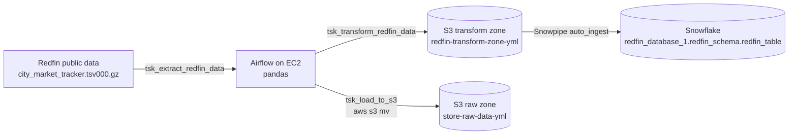

# Redfin Real-Estate Data Pipeline — Airflow · S3 · Snowpipe · Snowflake

An end-to-end batch pipeline that pulls Redfin's public city-level housing market data, cleans it with pandas inside an Apache Airflow DAG running on an EC2 (Ubuntu) host, stores raw and transformed copies in Amazon S3, and auto-ingests the transformed files into Snowflake with Snowpipe.

## Architecture



## Tech stack

- **Orchestration:** Apache Airflow 2.7 (`PythonOperator`, `BashOperator`) on Amazon EC2
- **Processing:** Python, pandas, boto3
- **Storage:** Amazon S3 (raw zone + transform zone)
- **Warehouse:** Snowflake (external stage, file format, Snowpipe with `auto_ingest = TRUE`)

## What it demonstrates

- **Extract:** reads the gzipped TSV straight from Redfin's public S3 URL and writes a timestamped local CSV
- **Transform:**
  - keeps 24 relevant columns and drops rows with nulls
  - strips commas from `city`
  - parses `period_begin` / `period_end` to dates
  - derives year and month columns and maps month numbers to names
  - uploads the result to the transform bucket with `boto3`
- **Load:** moves the untouched extract to a raw-zone bucket, so raw and curated data stay separated
- **Snowflake ingestion:** a target table, CSV file format, external stage on the transform bucket, and a Snowpipe that copies new files in automatically
- An exploratory notebook used to develop the transform logic before it went into the DAG

## Project structure

```
data_engineering_project_redfin__dataanalytics/
├── redfin_analytics.py                    # Airflow DAG: extract → transform → load
├── Extract_and_Transform_WorkBook.ipynb   # notebook used to prototype the transform
├── RealEstate_script.txt                  # Snowflake DDL: database, table, file format, stage, Snowpipe
├── commands_run.txt                       # EC2 setup commands (venv, pandas, boto3, awscli, airflow)
└── requirements.txt                       # pinned Python environment
```

## How to run

1. **EC2 / Linux host:** follow `commands_run.txt` — create a venv, then install pandas, boto3, awscli and Apache Airflow. Run `aws configure` with an IAM user or role that can write to your buckets.
2. **S3:** create two buckets (raw + transform) and update `target_bucket_name` in `redfin_analytics.py` and the `aws s3 mv` target in `tsk_load_to_s3`.
3. **Airflow:** copy `redfin_analytics.py` into `~/airflow/dags/`, start Airflow with `airflow standalone`, then trigger `redfin_analytics_dag`.
4. **Snowflake:** run `RealEstate_script.txt`. Replace the `xxxx` credentials in the stage, preferably with a storage integration. Then run `DESC PIPE …` and copy the `notification_channel` ARN into an S3 event notification on the transform bucket, so Snowpipe picks up new files.

## Possible next steps

- Replace the stage's access keys with a Snowflake storage integration (IAM role)
- Pass file paths between tasks without relying on the `/home/ubuntu` path
- Turn on the commented-out `@weekly` schedule and add data-quality checks
- Build a Power BI / Tableau dashboard on top of the Snowflake table
